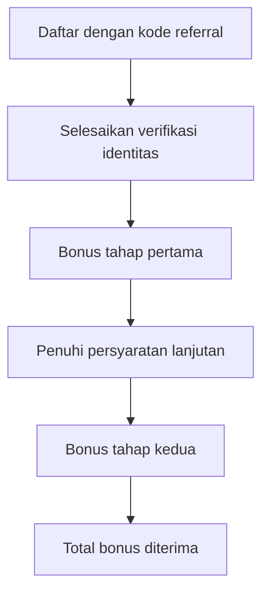

# Kode Referral {{ title }} Terbaru

Deskripsi pendahuluan program referral. Jelaskan platform, benefit umum, dan ringkas alur dapatkan bonus.

## Kode Referral

Masukkan kode berikut saat mendaftar:

**[KODE_REFERRAL]**

Atau gunakan link referral langsung:
[Daftar dengan referral link](https://example.com/[REFERRAL_LINK])

## Keuntungan Program Referral

Jelaskan benefit utama program ini.

### 1. Bonus Pertama

Penjelasan tahap bonus pertama dan persyaratan.

### 2. Bonus Tambahan

Penjelasan tahap bonus kedua dan persyaratan lanjutan.

### 3. Total Bonus

Ringkasan total bonus jika semua persyaratan terpenuhi.

| Tahapan | Persyaratan | Bonus |
|---------|-------------|-------|
| Tahap 1 | Daftar dan verifikasi | [BONUS] |
| Tahap 2 | [Persyaratan lanjutan] | [BONUS] |
| Total | Lengkap semua | [TOTAL] |

## Alur Klaim Bonus

## Syarat Mendapatkan Bonus

1. Daftar akun baru menggunakan kode referral.
2. Selesaikan verifikasi identitas (KYC).
3. [Persyaratan lanjutan: deposit, trading, dll.]
4. Jangan melakukan aktivitas yang melanggar ketentuan.

## Cara Mendaftar dan Verifikasi

1. Buka platform resmi.
2. Pilih menu Daftar.
3. Masukkan kode referral: **[KODE_REFERRAL]**
4. Lengkapi informasi kontak.
5. Selesaikan verifikasi identitas.

## Cara Klaim Bonus

Setelah persyaratan terpenuhi:

1. Masuk ke akun.
2. Buka menu Reward atau Hadiah.
3. Cek bonus yang tersedia.
4. Klik tombol klaim.

## FAQ

### Berapa bonus yang bisa didapat?

Total bonus hingga [JUMLAH] untuk pengguna baru yang menyelesaikan semua persyaratan.

### Berapa lama bonus diklaim?

Biasanya bonus muncul dalam [DURASI] hari setelah persyaratan terpenuhi.

### Apakah bonus bisa ditransfer?

[Jawab sesuai kebijakan platform]

### Bagaimana jika bonus belum masuk?

Periksa apakah semua persyaratan sudah terpenuhi. Hubungi layanan pelanggan jika ada masalah.

## Kesimpulan

Kode referral **[KODE]** memberikan kesempatan mendapat bonus hingga **[JUMLAH]** untuk pengguna baru. Ikuti panduan di atas untuk memastikan semua persyaratan terpenuhi dan bonus dapat diklaim dengan lancar.
