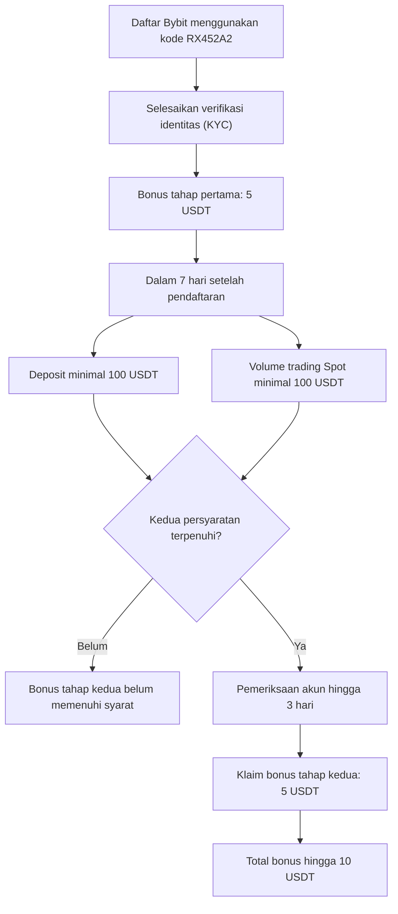

Bybit adalah platform trading cryptocurrency yang menawarkan layanan derivatif dan spot trading dengan leverage tinggi. Untuk mendorong pendaftaran pengguna baru, Bybit menyediakan program referral yang memberikan bonus kepada pengguna baru yang mendaftar melalui kode referral.

Bagi Anda yang ingin mendapatkan bonus saat membuat akun di Bybit, pengguna baru bisa menggunakan kode referral **RX452A2**. Dengan memasukkan kode ini, pengguna baru berkesempatan memperoleh bonus hingga **10 USDT** setelah menyelesaikan pendaftaran, verifikasi identitas, serta persyaratan deposit dan trading.

Bonus diberikan melalui dua tahapan. Pertama, pengguna dan pemberi referral masing-masing memperoleh 5 USDT setelah pengguna baru mendaftar dan menyelesaikan verifikasi identitas. Selanjutnya, tersedia tambahan hadiah 5 USDT apabila pengguna melakukan deposit dan transaksi sesuai persyaratan program.

Kami akan membahas cara menggunakan kode referral RX452A2, rincian bonus, syarat pendaftaran, dan langkah klaim hadiah agar Anda dapat mengikuti program dengan benar.

## Kode Referral Bybit RX452A2

Bagi Anda yang ingin membuat akun Bybit Indonesia, masukkan kode referral berikut saat melakukan pendaftaran:

**RX452A2**

Kode referral perlu dimasukkan ketika membuat akun baru agar hubungan referral tercatat dengan benar. Pastikan kode sudah terpasang sebelum menyelesaikan registrasi.

Program referral Bybit Indonesia memberikan kesempatan kepada pengguna baru untuk mendapatkan hadiah hingga 10 USDT. Jumlah tersebut terdiri dari dua tahapan reward yang memiliki persyaratan masing-masing.

## Bagaimana Alurnya?

## Keuntungan Menggunakan Kode Referral Bybit

Dengan menggunakan kode referral RX452A2, Anda dapat mengikuti program hadiah pengguna baru Bybit Indonesia.

### 1. Bonus 5 USDT setelah daftar dan verifikasi

Pengguna baru dan pemberi referral masing-masing berkesempatan mendapatkan airdrop sebesar **5 USDT** setelah pengguna yang diundang berhasil mendaftar dan menyelesaikan verifikasi identitas.

Karena itu, pastikan proses KYC berhasil diselesaikan agar dapat mengikuti tahapan hadiah pertama.

### 2. Bonus tambahan 5 USDT

Selain hadiah pertama, tersedia tambahan **5 USDT** untuk masing-masing pihak apabila pengguna baru memenuhi persyaratan lanjutan.

Persyaratannya adalah melakukan deposit minimal 100 USDT dan mencapai volume trading Spot minimal 100 USDT dalam waktu tujuh hari setelah mendaftar.

### 3. Total bonus hingga 10 USDT

Jika kedua tahapan berhasil diselesaikan, pengguna baru berkesempatan mendapatkan total **10 USDT**.

| Tahapan        | Persyaratan                                                             | Bonus pengguna baru |
| -------------- | ----------------------------------------------------------------------- | ------------------: |
| Hadiah pertama | Daftar dan selesaikan verifikasi identitas                              |              5 USDT |
| Hadiah kedua   | Deposit minimal 100 USDT dan trading Spot minimal 100 USDT dalam 7 hari |              5 USDT |
| **Total**      | Menyelesaikan kedua tahapan                                             |         **10 USDT** |

Bonus diberikan sesuai ketentuan dan hasil pemeriksaan akun oleh Bybit.

## Syarat Mendapatkan Bonus Referral Bybit

Agar bisa mengikuti program referral, pastikan Anda memenuhi persyaratan berikut:

1. Membuat akun baru Bybit Indonesia menggunakan kode referral RX452A2.
2. Menyelesaikan verifikasi identitas atau KYC.
3. Melakukan deposit minimal 100 USDT dalam tujuh hari setelah pendaftaran untuk mendapatkan hadiah tahap kedua.
4. Mencapai total volume trading Spot minimal 100 USDT dalam tujuh hari setelah pendaftaran.
5. Tidak melakukan aktivitas yang melanggar ketentuan program.

Ada beberapa ketentuan tambahan yang perlu diperhatikan:

- Deposit melalui transfer internal atau dari akun Bybit lain tidak dihitung sebagai deposit yang memenuhi syarat.
- Pasangan trading Spot dengan biaya nol tidak dihitung dalam volume trading.
- Deposit yang memenuhi ketentuan mencakup pembelian sekali klik, deposit kripto, dan deposit fiat.
- Hadiah dapat ditinjau terlebih dahulu sebelum tersedia untuk diklaim.

Kami menyarankan Anda menyelesaikan seluruh persyaratan sesuai batas waktu agar tidak kehilangan kesempatan mendapatkan bonus.

## Cara Menggunakan Kode Referral Bybit RX452A2

Untuk mengikuti program referral, masukkan kode RX452A2 sejak awal pendaftaran.

1. **Buka Bybit Indonesia.** Akses situs atau aplikasi resmi Bybit Indonesia.
2. **Pilih menu Daftar.** Mulai proses pembuatan akun baru.
3. **Masukkan email atau nomor ponsel.** Gunakan informasi kontak yang aktif.
4. **Isi kode referral.** Masukkan **RX452A2** pada kolom kode referral.
5. **Buat kata sandi.** Ikuti ketentuan keamanan akun yang ditampilkan.
6. **Selesaikan verifikasi kontak.** Masukkan kode verifikasi yang dikirimkan.
7. **Lakukan verifikasi identitas.** Lengkapi proses KYC sesuai instruksi aplikasi.

Pastikan kode referral sudah tercatat ketika pendaftaran selesai. Bybit tidak mengizinkan pengguna menambahkan atau mengganti kode referral setelah akun berhasil dibuat.

## Cara Mendapatkan Bonus Tambahan 5 USDT

Setelah berhasil mendaftar dan menyelesaikan KYC, Anda dapat melanjutkan ke persyaratan hadiah kedua.

Berikut langkah yang perlu dilakukan:

1. Masuk ke akun Bybit Indonesia.
2. Lakukan deposit minimal 100 USDT atau nilai setara melalui metode deposit yang memenuhi ketentuan.
3. Pastikan deposit dilakukan dalam tujuh hari setelah pendaftaran.
4. Lakukan transaksi Spot hingga mencapai akumulasi volume minimal 100 USDT.
5. Selesaikan seluruh persyaratan dalam batas waktu yang ditentukan.
6. Periksa perkembangan tugas dan hadiah melalui halaman Referral atau Hub Hadiah.

Perlu diingat bahwa jumlah deposit dan volume trading merupakan dua persyaratan berbeda. Deposit 100 USDT tidak otomatis dihitung sebagai volume trading 100 USDT.

## Cara Klaim Bonus Referral Bybit

Setelah menyelesaikan persyaratan, hadiah tidak selalu langsung tersedia untuk digunakan. Bybit melakukan pemeriksaan terhadap akun peserta sebelum reward dapat diklaim.

Berdasarkan ketentuan referral Bybit Indonesia, pemeriksaan dapat berlangsung hingga tiga hari. Apabila tidak ditemukan aktivitas yang tidak wajar, pengguna dapat mengklaim hadiah melalui Hub Hadiah.

Langkahnya:

1. Buka aplikasi Bybit Indonesia.
2. Masuk ke menu Hub Hadiah atau Rewards Hub.
3. Periksa hadiah referral yang tersedia.
4. Pilih hadiah yang sudah memenuhi syarat.
5. Tekan tombol klaim jika sudah tersedia.
6. Periksa saldo akun setelah hadiah berhasil diklaim.

Hadiah yang telah tersedia untuk diklaim memiliki masa klaim 30 hari. Karena itu, jangan lupa memeriksa Hub Hadiah secara berkala.

## Mengapa Bonus Referral Bybit Belum Masuk?

Apabila bonus belum muncul, periksa beberapa hal berikut.

**1. Verifikasi identitas belum selesai**

Pastikan proses KYC berhasil dan status akun sudah terverifikasi.

**2. Deposit belum memenuhi jumlah minimum**

Untuk mendapatkan hadiah kedua, pengguna perlu melakukan deposit minimal 100 USDT melalui metode yang diakui program.

**3. Volume trading belum mencapai target**

Pastikan volume trading Spot sudah mencapai 100 USDT. Deposit tidak termasuk sebagai volume perdagangan.

**4. Persyaratan melewati batas waktu**

Deposit dan aktivitas trading untuk hadiah kedua harus diselesaikan dalam tujuh hari setelah pendaftaran.

**5. Hadiah masih dalam pemeriksaan**

Bybit dapat memeriksa status akun selama maksimal tiga hari sebelum hadiah tersedia untuk diklaim.

Jika seluruh persyaratan sudah dipenuhi tetapi bonus belum tersedia, periksa riwayat referral atau hubungi layanan bantuan Bybit Indonesia.

## FAQ Kode Referral Bybit RX452A2

### Apa kode referral Bybit terbaru?

Kode referral Bybit yang bisa digunakan adalah **RX452A2**.

### Berapa bonus pengguna baru Bybit?

Pengguna baru berkesempatan memperoleh total hingga 10 USDT, terdiri dari 5 USDT setelah pendaftaran dan verifikasi serta tambahan 5 USDT setelah memenuhi persyaratan deposit dan trading.

### Apakah bonus 10 USDT langsung diberikan setelah daftar?

Tidak. Bonus diberikan melalui dua tahapan. Pengguna harus menyelesaikan KYC dan memenuhi persyaratan deposit serta trading untuk mendapatkan seluruh hadiah.

### Berapa deposit minimum untuk mendapatkan bonus tambahan?

Deposit minimum yang disyaratkan adalah 100 USDT atau nilai setara dalam aset yang memenuhi ketentuan program.

### Berapa volume trading yang harus dicapai?

Pengguna perlu mencapai volume trading Spot minimal 100 USDT dalam tujuh hari setelah pendaftaran.

### Apakah transfer internal dihitung sebagai deposit?

Tidak. Transfer internal atau transfer dari akun Bybit lain tidak dihitung sebagai deposit yang memenuhi syarat program.

### Kapan bonus dapat diklaim?

Setelah pemeriksaan akun selesai. Bybit menyebutkan pemeriksaan dapat berlangsung hingga tiga hari dan hadiah yang tersedia perlu diklaim dalam 30 hari.

### Apakah kode referral bisa ditambahkan setelah mendaftar?

Tidak. Kode referral harus dimasukkan saat registrasi karena hubungan referral tidak dapat ditambahkan atau diubah setelah akun dibuat.

## Kesimpulan

Kode referral Bybit **RX452A2** memberikan kesempatan kepada pengguna baru untuk memperoleh bonus hingga **10 USDT** melalui program referral Bybit Indonesia. Pengguna bisa mendapatkan 5 USDT setelah mendaftar dan menyelesaikan verifikasi identitas, kemudian memperoleh tambahan 5 USDT setelah deposit minimal 100 USDT dan mencapai volume trading Spot minimal 100 USDT dalam tujuh hari.

Untuk mengikuti program, masukkan kode RX452A2 saat membuat akun dan pastikan seluruh persyaratan diselesaikan sesuai batas waktu. Periksa Hub Hadiah untuk mengklaim bonus setelah proses pemeriksaan akun selesai.